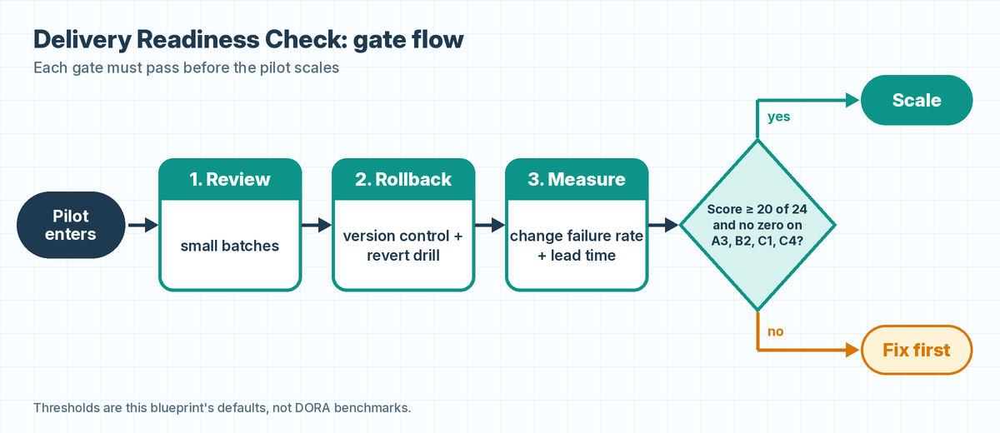

# delivery-readiness-check

DORA's 2025 industry survey report (*State of AI-assisted Software Development 2025*, v. 2025.2, 4,867 respondents) finds AI adoption associated with higher software delivery throughput and, still, higher delivery instability. This kit gates an AI coding pilot on review, rollback and measurement before it scales, and computes change fail rate and lead time from your own deploy history.

It is not a DORA product and publishes no DORA benchmarks.

## Contents
- `docs/checklist.md`: 12 scored items (0/1/2, max 24) across review, rollback, measurement and policy, each mapped to a DORA AI capability with a report page reference, plus scoring bands.
- `delivery_metrics.py`: standard library only, Python 3.9+. Change fail rate, median and p90 lead time, split by `ai_assisted`. Exit 0 pass, 1 fail, 2 bad input.
- `tests/test_delivery_metrics.py`: 4 unit tests (hand-computed values, input rejection, exit codes).
- `examples/example_deploys.csv`: **synthetic example data** (30 rows, seeded random). It describes no real team. See `examples/EXAMPLE_DATA_README.txt`.
- `docs/gate-flow.mmd` and `docs/gate-flow.png`: the gate flow (pilot enters, Review, Rollback, Measure, then Scale or Fix first).



## Run
```bash
python delivery_metrics.py examples/example_deploys.csv --max-cfr 0.15 --max-lead-hours 24
python -m unittest discover -s tests     # or: pytest -q
```
CSV columns: `deploy_id, commit_time, deploy_time, failed, ai_assisted` (ISO 8601 with offset). `failed` is true when the deploy needed immediate intervention (rollback or hotfix), DORA's change fail rate definition (report p. 13). Lead time is commit to production.

The 15% and 24h defaults and the score bands are starting points, not DORA benchmarks. Set your own.

## Example run (synthetic data)
On the bundled synthetic data: 16.7% change fail rate overall, 26.7% AI-assisted, 6.7% not, 9.9h median lead time; the default 15% check fails (exit 1). Tested on Python 3.13.5, Linux 6.12, 8 vCPU: 4 tests OK.

## Limits
- DORA's findings are survey associations, not controlled trials. Passing this check does not prove stability will follow.
- Not tested on any real team's deploy history yet. Results depend on how honestly `failed` is labelled.
- Covers 4 of DORA's 7 AI capabilities and 2 of its 5 delivery metrics.

## Source
DORA, *State of AI-assisted Software Development 2025*, v. 2025.2: https://dora.dev/research/2025/dora-report/

## License
MIT.
